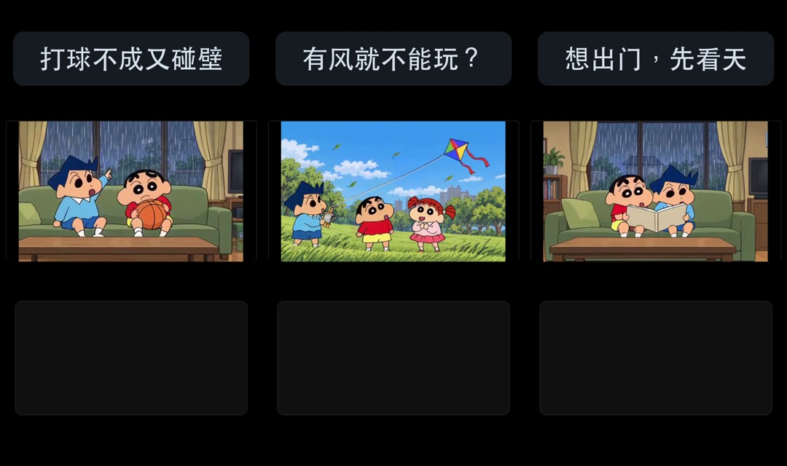
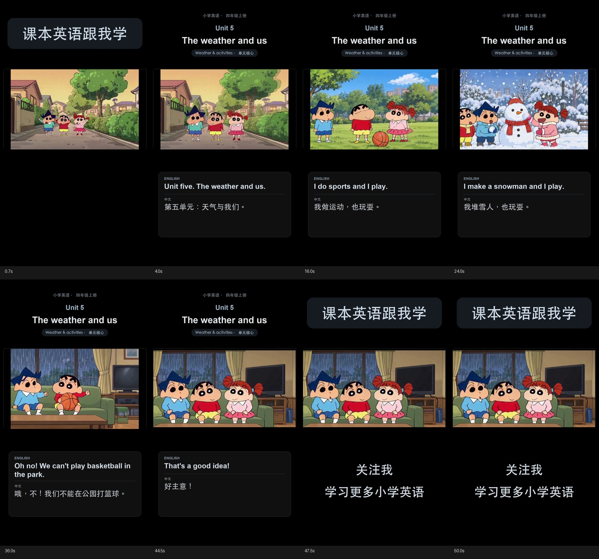

# 四年级上册 Unit 5 — The weather and us

沿用蜡笔小新、风间、妮妮的固定外观与英语声线。2026-10-25按用户要求重做为三集约15秒的冲突/猜题短片，具体文件与复核见[三集制作记录](edit/short-series-v11.md)。**交付为可播放预览，完整人工听检与用户验收仍待完成。**

## 最新三集短版 v11

| 集 | 时长 | 内容 / 文件 |
| --- | --- | --- |
| ① 打球不成又碰壁 | 15.29秒 | [下雨打不了球→图书馆关门→去看电影](renders/unit-5-ep01-rainy-plans-black-v11.mp4) |
| ② 有风就不能玩？ | 15.00秒 | [风天/雪天，先选活动再听答案](renders/unit-5-ep02-windy-snowy-black-v11.mp4) |
| ③ 想出门，先看天 | 15.46秒 | [雨天在家与晴天运动的情境对照](renders/unit-5-ep03-rainy-sunny-black-v11.mp4) |

每集首镜2秒问题叠字，教材英语约0.1秒开始；保留固定黑底与大字号双语字幕，每集独立给出答案。复用14条已有台词/动画，无新供应商调用。v10第一轮候选保留，v11裁去EP01原TTS正文之后的额外尾声，原WAV不变。三集完整解码、实际MP4英语ASR匹配、代表帧目视及浏览器1倍完整静音播放已完成，0丢帧/0削波样本；人工全片听检与用户验收待完成。

[逐集脚本](script/dialogue-short-series-v11.md) · [剪辑清单](short-series-v11.json) · [制作/复核/文案与SHA](edit/short-series-v11.md) · [通用短集规则](../../SHORT_SERIES_GUIDE.md)。2026-10-25用户授权后，三集已依次发布，公开链接与平台证据见下方“约15秒三集v11发布记录”；当前不对短集流量效果作判断。

## 历史长版与源文件

## 导演流程优化（Issue #24，2026-10-26）

- #19工程部分已落地：[逐句绑定](characters/speaker-bindings-v1.json)覆盖本课18行；三集实际使用14行。v11的[EP01](edit/speaker-qa-v1/ep01.md)、[EP02](edit/speaker-qa-v1/ep02.md)、[EP03](edit/speaker-qa-v1/ep03.md)复核清单已生成，静态检查均pass，人工均pending，可发布状态均false。历史发布记录继续保留，不代表新增门禁已通过。
- 实际WAV/声线输入、镜头、配置、母版、字幕和导出SHA已核对；错voice profile会被拒绝，`--require-publishable`在人工pending时返回2。未新增测试代码；执行了真实产物检查和临时错误输入校验。
- 同目录`human-review-ep0N-template.json`供完整带声音复核后另存版本填写。静态声明是创作意图；代表帧核对不能代替实际声画听检。操作见[导演流程](../../DIRECTOR_WORKFLOW.md)。#19/#16保持打开；#23待P0人工基线通过后再启动。

## 历史长版与源文件（保留版本）

| 版本 | 时长 | 文件 |
| --- | --- | --- |
| **黑底中文童声栏目版 v9，正文1.2倍语速** | 50.08秒 | [黑底包装预览](renders/unit-5-the-weather-and-us-spoken-bookends-black-v9.mp4) |
| **黑底普通语速双语竖屏 v9** | 77.56秒 | [黑底双语预览](renders/unit-5-the-weather-and-us-vertical-bilingual-black-v9.mp4) |
| 历史白底中文童声栏目版，正文1.2倍语速 | 50.08秒 | [竖屏包装预览](renders/unit-5-the-weather-and-us-spoken-bookends-v7.mp4) |
| 普通语速白底双语竖屏 | 77.56秒 | [竖屏双语预览](renders/unit-5-the-weather-and-us-vertical-bilingual-white-v7.mp4) |
| 普通语速横屏双语烧录 | 77.56秒 | [横屏双语预览](renders/unit-5-the-weather-and-us-bilingual-burned-v7.mp4) |
| 无烧录字幕横屏母版 | 77.56秒 | [可复用母版](renders/unit-5-the-weather-and-us-master-v7.mp4) |

采用配置：[lesson-v7.json](lesson-v7.json)；逐句脚本：[dialogue-v7.md](script/dialogue-v7.md)；原时间轴[SRT](edit/subtitles-bilingual-v7.srt)；包装版[完整SRT](renders/unit-5-the-weather-and-us-spoken-bookends-v7.srt)及[18句正文SRT](renders/unit-5-the-weather-and-us-spoken-bookends-v7.body.srt)。

黑底后期沿用上述 v7 脚本、配音和时间轴；采用 `vertical-bilingual-black-v2`。最新包装版[完整SRT](renders/unit-5-the-weather-and-us-spoken-bookends-black-v9.srt)与[正文SRT](renders/unit-5-the-weather-and-us-spoken-bookends-black-v9.body.srt)、[黑底母版](renders/unit-5-the-weather-and-us-master-black-v9.mp4)、[复现配方与复核](edit/postproduction-black-v9.md)。

## 教材与范围

本地归档为人教版PEP四年级上册第三方扫描PDF；封面“2024审定”，扉页/版权资料确认人教社PEP四年级上册，具体版次、出版年/印次未能核实。原件保持不变；本课页图从原PDF渲染，SHA与来源性质见[教材来源记录](references/source-v1.md)。

本片选编印刷p.50核心问题、p.51八行天气/活动歌谣的普通朗读、p.52 Look and say底部问答、p.55 B Let's talk六轮；对应PDF第56/57/58/61页。18句英中脚本中，教材原文、人物替换、标题朗读和line-013删姓名改编均有明确记录。中文为本项目翻译；p.52天气是教材情境，非实时天气预报。

未覆盖p.52电话对话、p.53词汇活动、p.54语音训练/音频填空和后续拓展/歌曲。原版配套音频未归档，不猜写其内容或仿称原版旋律；只采用已目视核实的文字。

## 制作与检查状态

| 阶段 | 当前状态 | 证据 |
| --- | --- | --- |
| 教材/脚本 | 已核对18行，改编明确 | `references/source-v1.md`、`script/dialogue-v7.md` |
| 角色与声线 | 固定Milo/Dean/Mia，旁白独立 | `characters/character-bible-v2.md`、全局voice library |
| 分镜 | 9格新场景板和10镜头规划已生成并目视检查 | `storyboards/storyboard-v2.md`、`storyboard-scenes-v1.png`、场景参考manifest/生成prompt |
| TTS | 18条采用WAV完整解码，逐行/混音/实际成片ASR已筛查；0削波样本 | `audio/manifest-selected-v2.md`、`technical-qa-v1.json`、`export-asr-v7.json` |
| 动画 | 10/10采用任务succeeded并下载；代表帧已检查 | `renders/manifest-v7.md`、`provider-job-records-v1.json`、逐镜probe与图片 |
| 字幕与合成 | 四种输出已完成，18句配对一致 | `edit/assembly-v7.md`、SRT、配置和输出sidecar |
| 机器与播放检查 | v7四文件完整解码、packet DTS递增；v9三文件完整解码、与v7音频一致；两种黑底竖屏完整静音播放到尾、0丢帧 | `edit/export-qa-v7.json`、`export-qa-black-v9.json`、`browser-playback-black-v9.json` |
| 人工全片听检 | **待完成** | ASR/静音播放/抽帧不代表发音、声音自然度、音量和同步已人工验收 |
| 用户验收 | **待完成** | [Issue #16](https://github.com/tans/mantou/issues/16)继续跟踪；用户已于2026-10-24明确授权发布黑底v9 |

## 采用与返修关系

- line-013原v1/v2有独立尾词，均拒用；同Dean声线以最简style重配v3，实际原句已匹配。line-015采用v2去除疑似句首加词；其余16句复用v1。最终MP4英语正文归一化词序完全一致，中文片头片尾完整。
- 原shot-01 v1有重复妮妮，拒用保留；v2微动作返修后三人稳定。shot-09/10原片含供应商乱码字幕，仅合成时裁底部44px，人物表情、手势、书本/时钟保留；裁后拼图在storyboards。
- 服务为自有8188/turbo8，源帧512×320/124帧、约5.17秒。较长配音以末帧延长覆盖，逐镜时长和SHA保存在assembly JSON；不截断/加速教材母版配音。包装版按固定profile收紧长静音并保音高1.2倍，复用固定中文童声WAV。
- v6只缩短line-014中文译文排版，英文/音频未改；v7仅增加shot-09/10明确的合成裁切。历史脚本、配置、声音候选与原片均保留。

- v8为首次黑底中间稿：最后两镜的YUV420补边实际是上14/下16像素，初稿误用15/15留下1像素白线，因此拒用；v9按实测补边修正。保留v8便于追溯，观看和后续复用采用v9。v9不重配声音、不调用视频服务，仅重导出后期；字幕、音频和语速与v7一致。

## 已知限制与下一步

shot-06小新略贴左边缘，shot-04妮妮衣摆有轻微重影；独立TTS不声称逐词口型同步。原始源动画分辨率较低，导出1080×1920不是原生1080p动画。完整参数、输出SHA、尾音保持与视听边界见[复核报告](edit/qa-v7.md)。

下一步：优先完整听检三集短版，确认发音、语速、音色、响度、字幕同步与尾音；记录用户验收后由Issue #16收尾。约15秒三集制作由Issue #18独立跟踪。历史长版保留用于比较，未验收前保持预览状态。

## 抖音发布记录

- 用户于2026-10-24明确要求“发布吧”，发布目标为最新黑底中文童声栏目版v9，账号为“馒头工作室”（抖音号 `69260421328`）。
- 提交文件：[50.08秒黑底栏目版](renders/unit-5-the-weather-and-us-spoken-bookends-black-v9.mp4)，SHA-256：`c474c1638679b480de66ec9ebe4a2bfab94055b4070f38fc5517b9c75c5b42e0`。仅提交一次；原视频内容和配音未变。
- 标题：**四年级英语Unit 5｜跟小新学天气和活动**。
- 简介：人教版PEP四年级上册 Unit 5《The weather and us》单元核心选编。和小新、风间、妮妮一起练习天气表达与活动问答，中英双语跟读。收藏起来，每天练一点英语。
- 五个话题均从平台精确建议中选中，并核对为真实话题标签：`#四年级英语`、`#小学英语`、`#人教版英语`、`#英语跟读`、`#亲子英语`。
- 发布设置：公开、立即发布、不同时发布至其他平台；自主声明为“内容由AI生成”。
- 封面：3:4竖封面与4:3横封面均选取三人公园同框的视频帧，黑底配“四年级英语·天气与活动”文字，未遮挡人物脸部。横封面调整取景以移除底部残缺字幕卡；平台仍对竖封面提示“请勿使用截屏当封面”，提示可能影响流量，未阻止提交。
- **2026-10-24 06:23（Asia/Shanghai）已提交；06:24核验时为“审核中”。** [创作者中心内容管理](https://creator.douyin.com/creator-micro/content/manage?enter_from=publish)中找到标题完全匹配、时长00:50的作品卡，显示平台时间“2026年10月24日 06:23”和“审核中”。尚未取得作品ID或公开URL，不将提交成功写成公开发布完成。
- 提交前设置和卡片原文证据见[发布记录JSON](edit/douyin-publish-black-v9.json)。创作者中心页面保留在BrowserOS Neo供查看；本次未安排定时跟进，审核中不编辑、删除或重复提交。人工全片听检状态保持待完成。

## 约15秒三集 v11 发布记录（2026-10-25）

用户在三集交付后明确要求“发布吧”，本次授权范围为EP01/02/03的v11文件。已重新核对三条SHA与交付清单一致；账号为“馒头工作室”（抖音号`69260421328`），每条仅提交一次。

| 集 | 实际平台标题 | 发布时间（Asia/Shanghai） | 当前状态 / 公开链接 |
| --- | --- | --- | --- |
| EP01 | 小新想打球，却连碰两次壁｜四年级英语Unit 5① | 2026-10-25 12:07 | [已发布，公开页视频已加载](https://www.douyin.com/video/7700452247561375016) |
| EP02 | 刮风就不能玩？风间第一个不同意｜Unit 5② | 2026-10-25 12:10 | [已发布，公开页视频已加载](https://www.douyin.com/video/7700452977676389668) |
| EP03 | 小新能不能出门，天气说了算｜Unit 5③ | 2026-10-25 12:12 | [已发布，公开页视频已加载](https://www.douyin.com/video/7700453533761473855) |

- 三条均为公开、立即发布、不同时发布到其它平台，保存权限允许；自主声明为“内容由AI生成”。五个话题逐条从平台精确建议中选择，并核对为真正的话题节点：`#四年级英语`、`#小学英语`、`#人教版英语`、`#英语跟读`、`#亲子英语`，没有仅粘贴井号文字冒充选中。
- 三条均设置3:4竖封面与4:3横封面，并通过平台“封面效果检测通过／暂未发现封面低质问题”。竖封面采用平台已有推荐AI封面：EP01“打球不成又碰壁／还能去哪”，EP02“放风筝超开心／有风就不能玩？”，EP03“想出门，先看天／学天气英语”；横封面同步或使用平台横版推荐，人物脸部保持完整。原视频文件和配音未改。
- 每条初次提交后分别观察到“审核中”；2026-10-25 12:17后台三条均已显示“已发布”。三个公开页面均使用BrowserOS Neo打开，核对对应标题、账号、AI声明与实际视频加载。平台转码视频约15秒、720×1280；公开页加载不是完整人工视听验收。
- 完整身份、简介、SHA、提交次数、状态变化、提交前设置及公开页证据见[发布总记录](edit/douyin-publish-short-series-v11.json)、[最终后台状态](edit/douyin-short-series-v11-final-status.json)、[公开页面证据](edit/douyin-short-series-v11-public-pages.json)。人工全片听检仍保持待完成；发布授权不替代该验收。当前未安排定时监测，不对刚发布的小样本作效果判断。
- 同次查看后台时，历史50秒v9也已显示“已发布”；本次没有编辑、删除或重复提交旧作品，其原始提交记录保留。
