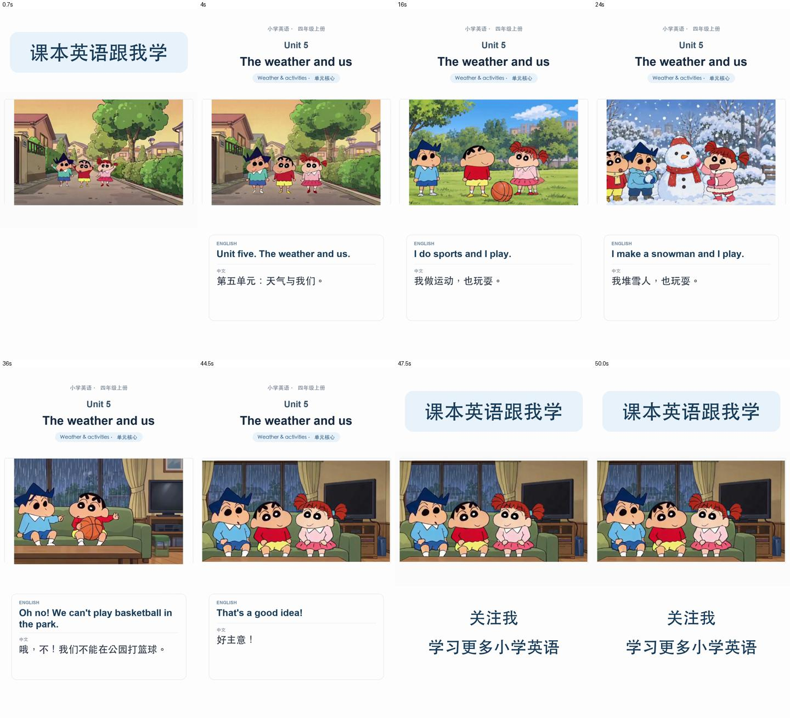

# 四年级上册 Unit 5 — The weather and us

沿用蜡笔小新、风间、妮妮的固定外观与英语声线，制作天气与活动的单元核心选编短片。**完整导出预览已完成；人工全片听检和用户验收待完成。**

## 观看与源文件

| 版本 | 时长 | 文件 |
| --- | --- | --- |
| 中文童声栏目版，正文1.2倍语速 | 50.08秒 | [竖屏包装预览](renders/unit-5-the-weather-and-us-spoken-bookends-v7.mp4) |
| 普通语速白底双语竖屏 | 77.56秒 | [竖屏双语预览](renders/unit-5-the-weather-and-us-vertical-bilingual-white-v7.mp4) |
| 普通语速横屏双语烧录 | 77.56秒 | [横屏双语预览](renders/unit-5-the-weather-and-us-bilingual-burned-v7.mp4) |
| 无烧录字幕横屏母版 | 77.56秒 | [可复用母版](renders/unit-5-the-weather-and-us-master-v7.mp4) |

采用配置：[lesson-v7.json](lesson-v7.json)；逐句脚本：[dialogue-v7.md](script/dialogue-v7.md)；原时间轴[SRT](edit/subtitles-bilingual-v7.srt)；包装版[完整SRT](renders/unit-5-the-weather-and-us-spoken-bookends-v7.srt)及[18句正文SRT](renders/unit-5-the-weather-and-us-spoken-bookends-v7.body.srt)。

## 教材与范围

本地归档为人教版PEP四年级上册第三方扫描PDF；封面“2024审定”，扉页/版权资料确认人教社PEP四年级上册，具体版次、出版年/印次未能核实。原件保持不变；本课页图从原PDF渲染，SHA与来源性质见[教材来源记录](references/source-v1.md)。

本片选编印刷p.50核心问题、p.51八行天气/活动歌谣的普通朗读、p.52 Look and say底部问答、p.55 B Let's talk六轮；对应PDF第56/57/58/61页。18句英中脚本中，教材原文、人物替换、标题朗读和line-013删姓名改编均有明确记录。中文为本项目翻译；p.52天气是教材情境，非实时天气预报。

未覆盖p.52电话对话、p.53词汇活动、p.54语音训练/音频填空和后续拓展/歌曲。原版配套音频未归档，不猜写其内容或仿称原版旋律；只采用已目视核实的文字。

## 制作与检查状态

| 阶段 | 当前状态 | 证据 |
| --- | --- | --- |
| 教材/脚本 | 已核对18行，改编明确 | `references/source-v1.md`、`script/dialogue-v7.md` |
| 角色与声线 | 固定Milo/Dean/Mia，旁白独立 | `characters/character-bible-v2.md`、全局voice library |
| 分镜 | 9格新场景板和10镜头规划已生成并目视检查 | `storyboards/storyboard-v2.md`、`storyboard-scenes-v1.png`、场景参考manifest/生成prompt |
| TTS | 18条采用WAV完整解码，逐行/混音/实际成片ASR已筛查；0削波样本 | `audio/manifest-selected-v2.md`、`technical-qa-v1.json`、`export-asr-v7.json` |
| 动画 | 10/10采用任务succeeded并下载；代表帧已检查 | `renders/manifest-v7.md`、`provider-job-records-v1.json`、逐镜probe与图片 |
| 字幕与合成 | 四种输出已完成，18句配对一致 | `edit/assembly-v7.md`、SRT、配置和输出sidecar |
| 机器与播放检查 | 四文件完整解码、packet DTS递增；包装版完整静音播放到尾、0丢帧 | `edit/export-qa-v7.json`、`browser-playback-v7.json` |
| 人工全片听检 | **待完成** | ASR/静音播放/抽帧不代表发音、声音自然度、音量和同步已人工验收 |
| 用户验收 | **待完成** | [Issue #16](https://github.com/tans/mantou/issues/16)继续跟踪；当前没有授权抖音发布 |

## 采用与返修关系

- line-013原v1/v2有独立尾词，均拒用；同Dean声线以最简style重配v3，实际原句已匹配。line-015采用v2去除疑似句首加词；其余16句复用v1。最终MP4英语正文归一化词序完全一致，中文片头片尾完整。
- 原shot-01 v1有重复妮妮，拒用保留；v2微动作返修后三人稳定。shot-09/10原片含供应商乱码字幕，仅合成时裁底部44px，人物表情、手势、书本/时钟保留；裁后拼图在storyboards。
- 服务为自有8188/turbo8，源帧512×320/124帧、约5.17秒。较长配音以末帧延长覆盖，逐镜时长和SHA保存在assembly JSON；不截断/加速教材母版配音。包装版按固定profile收紧长静音并保音高1.2倍，复用固定中文童声WAV。
- v6只缩短line-014中文译文排版，英文/音频未改；v7仅增加shot-09/10明确的合成裁切。历史脚本、配置、声音候选与原片均保留。

## 已知限制与下一步

shot-06小新略贴左边缘，shot-04妮妮衣摆有轻微重影；独立TTS不声称逐词口型同步。原始源动画分辨率较低，导出1080×1920不是原生1080p动画。完整参数、输出SHA、尾音保持与视听边界见[复核报告](edit/qa-v7.md)。

下一步：完整听完50秒包装版（必要时对照普通语速版），确认发音、语速、音色、响度、字幕同步与尾音，再记录用户验收并关闭Issue。未验收前保持“完整导出预览”。
